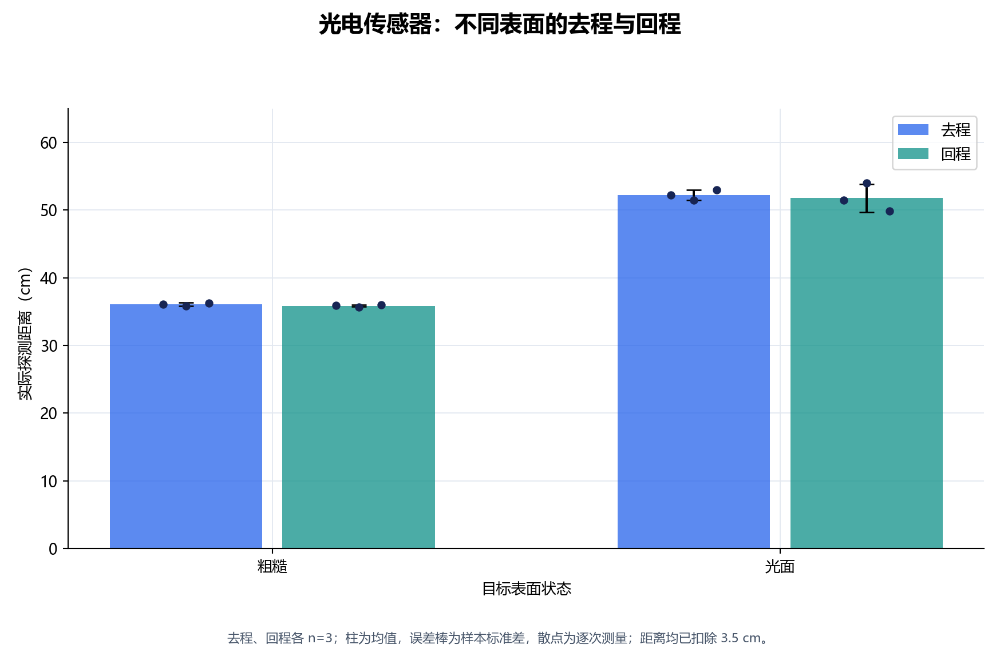
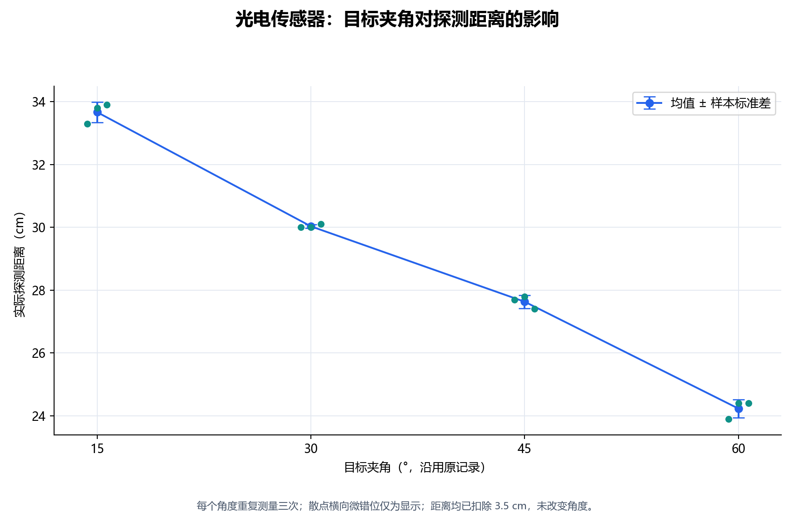
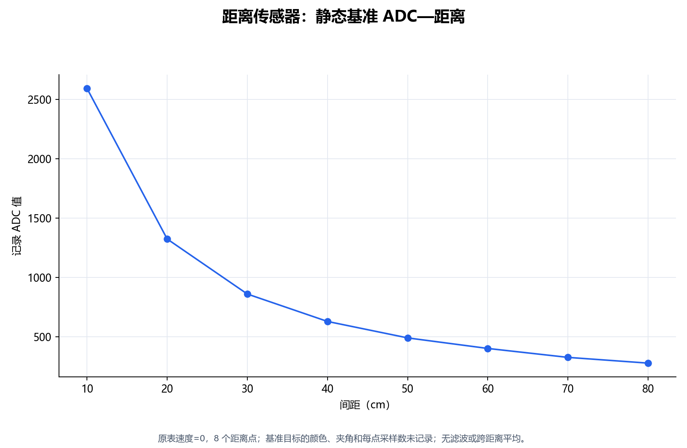
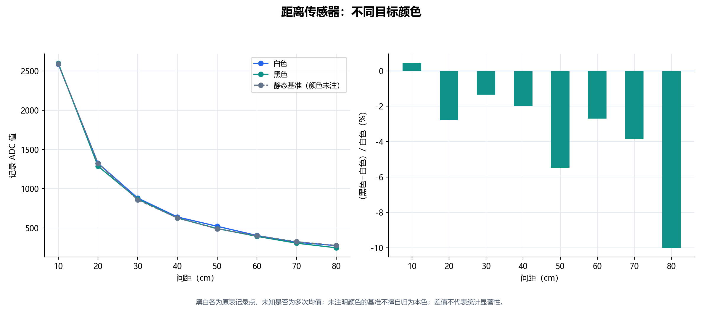
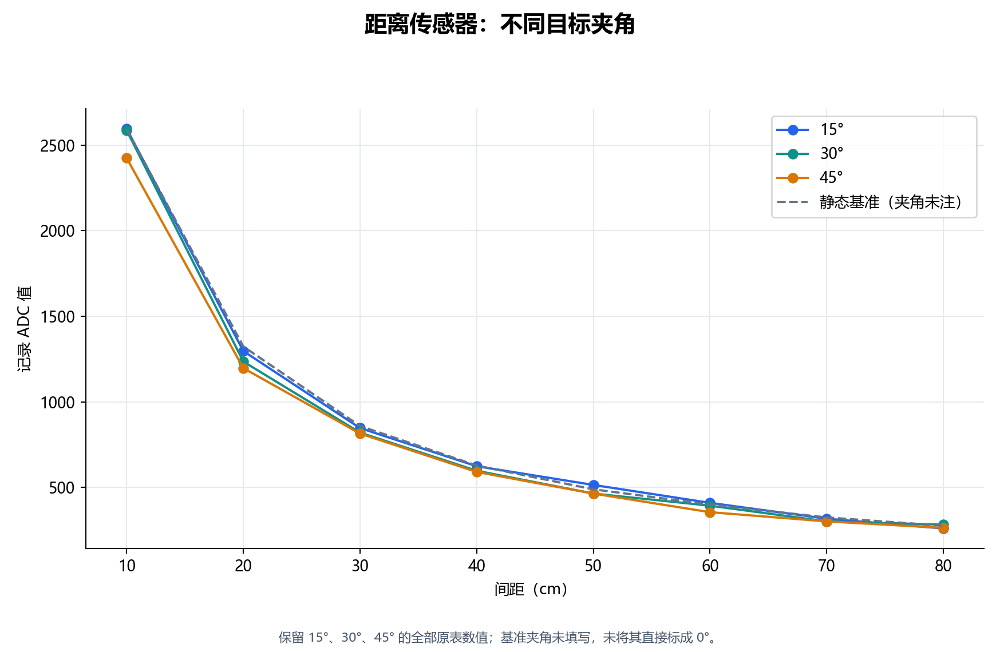
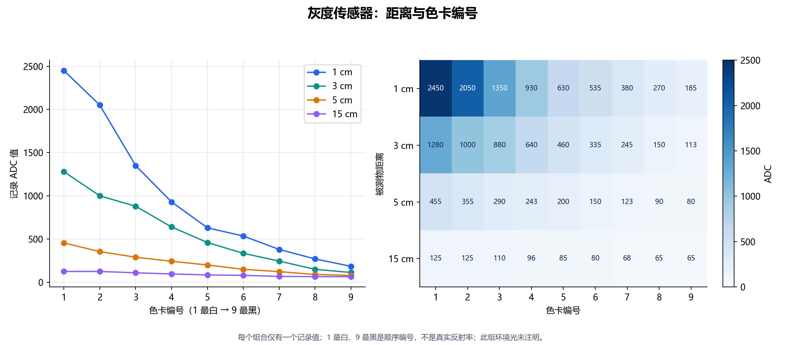
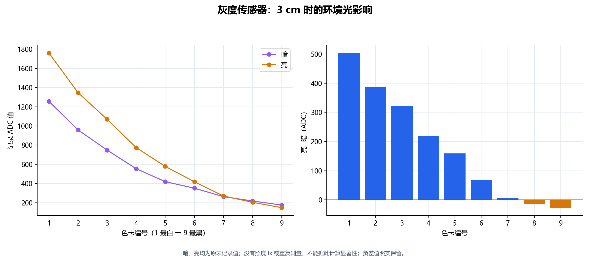
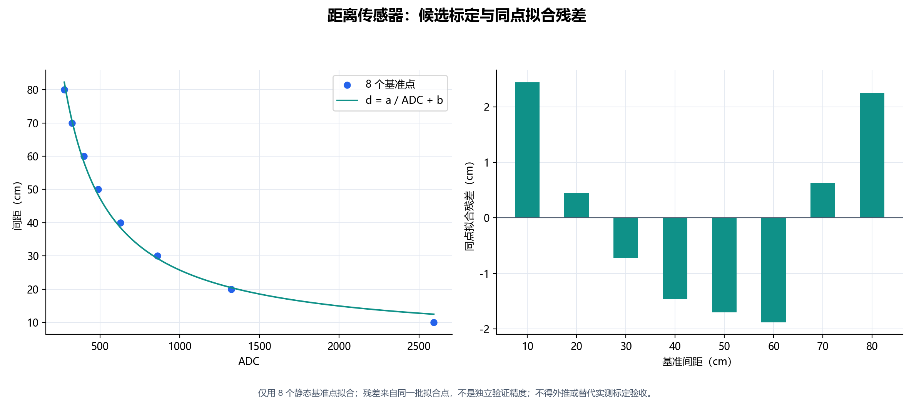

# 传感器实验数据记录与绘图

本记录依据老师提出的反光条件、目标夹角、动态测距、颜色、标定/噪声、灰度与光照要求整理。原始工作簿只读保留，新增整理文件与图在本目录。

## 已确认的数据解释

- 光电读数为尺上位置，统一减去传感器末端 3.5 cm；整理表仅显示扣除后的距离，尺上读数保留在源文件中。
- 光电角度的三列是三次重复测量，计算均值与样本标准差。
- 灰度色卡编号 1 最白、9 最黑；编号不是实测反射率。
- 距离与灰度表中的ADC小数/整数照原表保存；未注明每点是单次值还是若干次均值，不擅自假定。

## 记录清单

共整理 126 个有来源单元格的标量记录：光电 24、距离 48、灰度 54。另有四速度动态 CSV，与本表静态记录分开保留。

| 项目 | 条件及数量 | 当前状态 |
|---|---|---|
| 光电表面 | 粗糙/光面 × 去程/回程 × 3次 | 有记录及重复性统计 |
| 光电角度 | 15/30/45/60° × 3次 | 有记录及重复性统计 |
| 距离静态 | 10～80cm，每10cm一点，速度0 | 有8点，颜色/夹角未注明 |
| 距离颜色 | 白色/黑色 × 8距离 | 有16值，本色未明确 |
| 距离角度 | 15/30/45° × 8距离 | 有24值，基准角度未明确 |
| 灰度距离/色卡 | 1/3/5/15cm × 9色卡 | 有36值，环境光未注明 |
| 灰度光照 | 暗/亮 × 3cm × 9色卡 | 有18值，照度和重复未记录 |

## 光电记录摘要

所有距离单位cm；±为样本标准差，n=3。

| 表面 | 去程均值±SD | 回程均值±SD | 平均绝对回程差 |
|---|---:|---:|---:|
| 粗糙 | 36.067 ± 0.252 | 35.867 ± 0.153 | 0.200 |
| 光面 | 52.233 ± 0.751 | 51.800 ± 2.066 | 2.100 |

| 角度 | 平均探测距离cm | 样本标准差cm |
|---|---:|---:|
| 15° | 33.667 | 0.321 |
| 30° | 30.033 | 0.058 |
| 45° | 27.633 | 0.208 |
| 60° | 24.233 | 0.289 |

## 本批数据的主要观察

- 光面目标的平均探测距离大于粗糙目标；光面回程记录的离散程度也较大。这是当前三次记录的现象，目标材质/颜色未填写，不能单独归因为某一个表面光学参数。
- 光电夹角从15°增至60°时，平均探测距离由约33.67cm降至24.23cm。
- 距离传感器的黑白目标差异随距离变化：80cm时黑色247.5、白色275 ADC，相对白色约低10%；10cm时黑色略高于白色，不作统一方向的结论。
- 灰度记录在更近距离具有更大的色卡数值跨度：1cm时1号与9号差2265 ADC，15cm时差60 ADC；尚不能据此给出最优工作距离或噪声意义上的分辨率。
- 3cm灰度光照试验中，亮−暗在1号色卡为+504 ADC，在8、9号分别为−14、−27 ADC。负差保留，不能概括为增亮总是使ADC上升。

## 距离候选标定

使用原表8个静态基准点，拟合 `d(cm) = 21632.584448 / ADC + 4.103689`。仅在已记录的10～80cm、ADC 276.8～2593.3内讨论，不外推。

同点拟合RMSE约 1.611 cm，最大绝对残差约 2.445 cm。**这不是独立验证精度，也不是传感器的噪声标准差。** 原表基准目标颜色/角度未知，当前仅作候选模型，不能当各传感器均已完成标定。

色卡只有编号，没有真实反射率，因此没有编造灰度反射率标定。光电开关记录的是触发位置及回程，不与连续测距ADC混为同一种标定。

## 噪声处理边界

- 距离动态的四份CSV已另存原图和离线5点中值结果，见 ../raw_adc_distance/ 和 ../filtered_adc_distance/。
- 本表静态/颜色/角度/灰度多为每条件单个汇总值，没有对应的固定条件连续原始采样，不能计算时序噪声σ、信噪比或滤波改善率。
- 不把相邻距离或相邻色卡当作同一时间信号来做中值/均值滤波；这样会把真实条件变化混入噪声。
- 光电三次探测位置的标准差只表示边界重复性，不代表光电IO时间噪声。

## 还需补充的实验记录

1. 各传感器的型号/编号/通道、实验时间；目标材质、尺寸、颜色、粗糙度，夹角定义与照度。
2. 明确距离静态基准是否为本色、是否为正对；没有明确记录前不作该归类。
3. 固定距离下连续采集原始ADC/IO，保留时间戳；按相同条件重复，再评价噪声和实时滤波。
4. 距离标定后另选未参与拟合的距离点做独立验证；灰度需要有反射率依据的色卡才能报告物理标定。
5. 动态滑台同步位置/时间并重复各速度，保留停止后ADC变化现象；滤波不等于已补偿时间差。

## 图表

### 光电传感器：不同表面的去程与回程

去程、回程各 n=3；柱为均值，误差棒为样本标准差，散点为逐次测量；距离均已扣除 3.5 cm。

### 光电传感器：目标夹角对探测距离的影响

每个角度重复测量三次；散点横向微错位仅为显示；距离均已扣除 3.5 cm，未改变角度。

### 距离传感器：静态基准 ADC—距离

原表速度=0，8 个距离点；基准目标的颜色、夹角和每点采样数未记录；无滤波或跨距离平均。

### 距离传感器：不同目标颜色

黑白各为原表记录点，未知是否为多次均值；未注明颜色的基准不擅自归为本色；差值不代表统计显著性。

### 距离传感器：不同目标夹角

保留 15°、30°、45° 的全部原表数值；基准夹角未填写，未将其直接标成 0°。

### 灰度传感器：距离与色卡编号

每个组合仅有一个记录值；1 最白、9 最黑是顺序编号，不是真实反射率；此组环境光未注明。

### 灰度传感器：3 cm 时的环境光影响

暗、亮均为原表记录值；没有照度 lx 或重复测量，不能据此计算显著性；负差值照实保留。

### 距离传感器：候选标定与同点拟合残差

仅用 8 个静态基准点拟合；残差来自同一批拟合点，不是独立验证精度；不得外推或替代实测标定验收。
